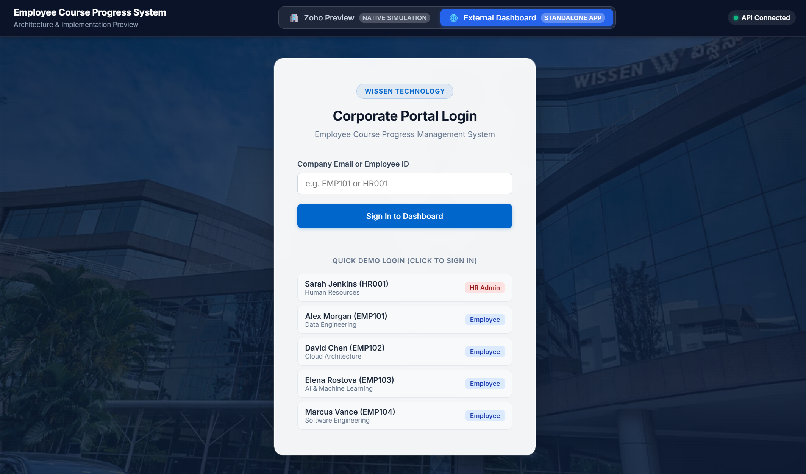
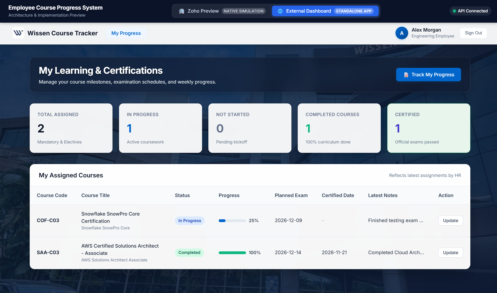
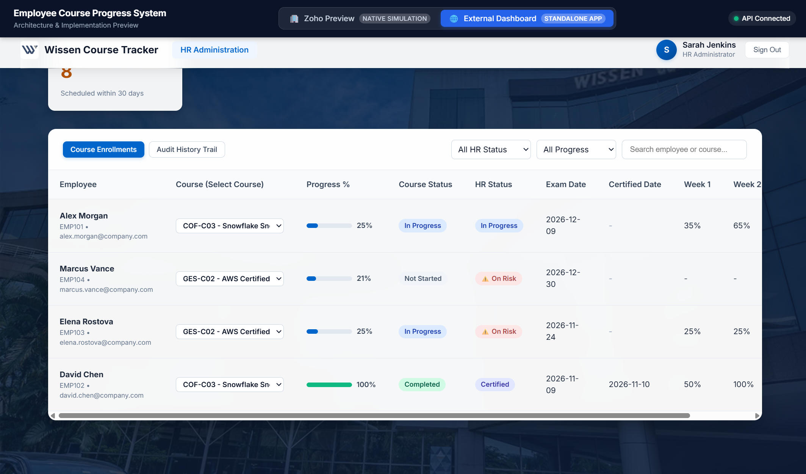
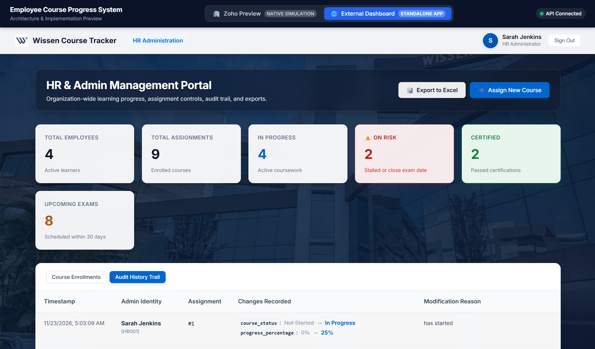
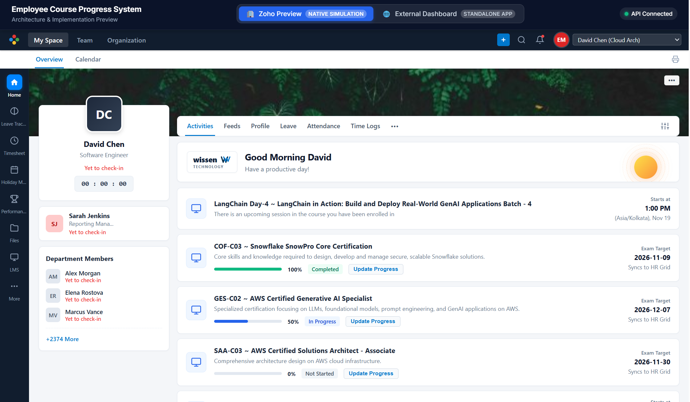
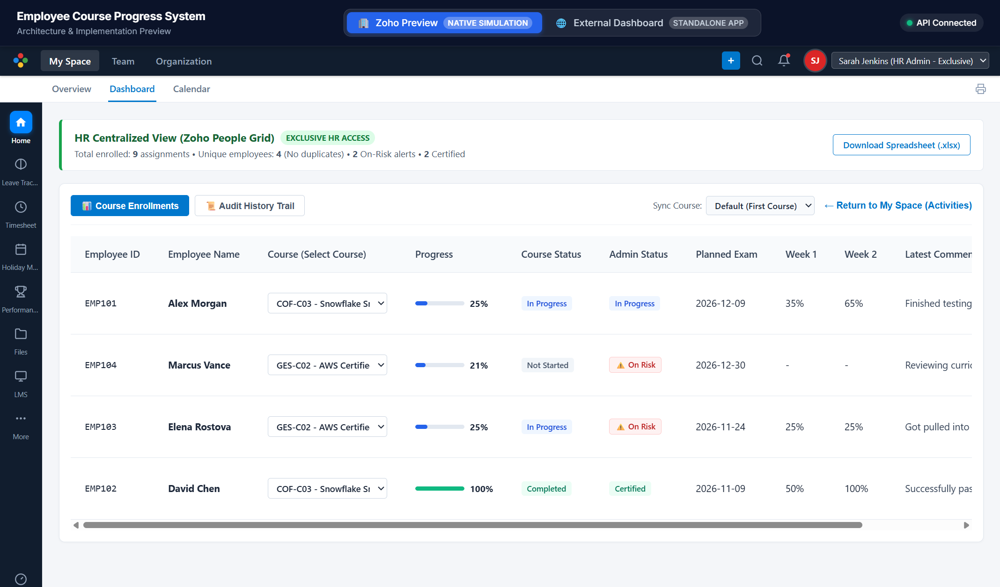

# Employee Course Progress & Certification Tracker

An enterprise-grade training and certification governance platform designed to replace fragile, manual spreadsheets with real-time progress tracking, audit trails, and automated risk detection.

---

## 30-Second Summary

- **The Problem:** Tracking employee technical certifications across teams using disconnected Excel files leads to stale progress, missed exam deadlines, duplicate assignments, and zero audit visibility.
- **The Solution:** A unified system that provides role-based self-service for employees, centralized oversight for HR/Managers, proactive **"On-Risk"** alerts for lagging candidates, and tamper-evident audit logging for administrative edits.
- **Dual-Preview Architecture:** The system ships with a live preview toggle comparing two deployment paradigms side-by-side:
  1. **External Corporate Web App:** A standalone, responsive portal with persona-based login, metric KPI cards, and comprehensive administrative controls.
  2. **Zoho People Native Simulation:** An embedded, low-friction integration mirroring the Zoho People workspace with zero-auth overhead.

---

## Quick Start (Under 1 Minute)

### 1. Start Backend & API
From the repository root, start the FastAPI server:

```bash
python -m uvicorn app.main:app --app-dir backend --reload --port 8000
```

### 2. Access the Application
Open your browser and navigate to:
**[http://localhost:8000](http://localhost:8000)**

*(The FastAPI server automatically serves the frontend at the root URL with all API endpoints mounted under `/api/`)*

---

## System Walkthrough & Key Features

### 1. Persona-Based Corporate Authentication
Seamlessly switch between sample learner and administrator personas to explore role-specific permissions and views without setup overhead.



---

### 2. Employee Learning Dashboard
Learners can track assigned certifications, review target exam deadlines, and submit real-time milestone updates.



* **Business-Rule Validation:**
  - *Not Started* locks progress to `0%`.
  - *In Progress* requires valid completion values (`1%` to `99%`).
  - *Completed* automatically locks progress to `100%` and prompts for exam/certification verification.
* **Submission History:** Every employee submission appends a timestamped progress snapshot to their audit trail.

---

### 3. HR Administration & Roster Management
HR managers monitor enterprise-wide training health with high-level KPI metrics, candidate status tracking, and duplicate prevention.



* **Deduplicated Employee Roster:** Each employee appears on a clean single row with an interactive in-grid course dropdown switcher for multi-course assignees.
* **Automated Risk Flags:** Candidates with upcoming exams but insufficient progress are automatically tagged with high-visibility **On Risk** status badges.
* **Duplicate Assignment Guard:** Attempting to assign an existing course to an employee is blocked at both client and database levels.
* **Excel Synchronization:** One-click download of a structured `.xlsx` spreadsheet matching corporate reporting formats.

---

### 4. Administrative Audit History Trail
Every administrative adjustment requires an explicit business justification and is recorded immutably with full attribution.



* **Grouped Event Logs:** Multi-field edits are consolidated into a single readable event row showing previous vs. updated values.
* **Accountability:** Captures administrator identity, timestamp, assignment ID, and mandatory change rationale.

---

### 5. Zoho People Ecosystem Simulation
Experience how the training tracker natively integrates within Zoho People's familiar employee and HR spaces.

| Employee Self-Service Space | HR Centralized Management Grid |
| :---: | :---: |
|  |  |
| Direct progress self-reporting inside Zoho Activities feed | Centralized grid with course switchers, status badges, and audit history |

---

## Demo Test Personas

Quickly test the system using pre-configured test profiles available directly on the login screen:

| Persona | Role | Department | Key Scenario to Test |
| :--- | :--- | :--- | :--- |
| **Alex Morgan** (`EMP101`) | Employee | Data Engineering | Active learner (`COF-C03` Snowflake, 25% complete). |
| **David Chen** (`EMP102`) | Employee | Cloud Architecture | Certified professional (`COF-C03` Snowflake, 100% Certified). |
| **Elena Rostova** (`EMP103`) | Employee | AI / Machine Learning | **On Risk** candidate (exam in under 5 days, progress at 25%). |
| **Marcus Vance** (`EMP104`) | Employee | Enterprise Systems | Multi-course enrollee testing course switching & status changes. |
| **Sarah Jenkins** (`HR001`) | HR Admin | People Operations | Full administrative access: course assignment, record edits, audit review, and Excel export. |

---

## Architecture & Technology Stack

```
Progress tracker/
├── backend/
│   ├── app/
│   │   ├── main.py              # FastAPI application & static file mounting
│   │   ├── database.py          # SQLAlchemy engine & session setup
│   │   ├── models.py            # SQLite database models (Employee, Course, Assignment, AuditLog)
│   │   ├── schemas.py           # Pydantic v2 validation schemas
│   │   ├── seed_data.py         # Initial mock dataset and business scenario seeding
│   │   └── routers/
│   │       ├── employee.py      # Employee-facing REST API endpoints
│   │       └── admin.py         # HR admin REST API endpoints & Excel export
│   └── progress_tracker.db      # Local SQLite database
└── frontend/
    ├── index.html               # Single-page shell with top-level preview switcher
    ├── css/                     # Modern modular styling
    ├── img/                     # Renamed application screenshot assets
    └── js/
        ├── app.js               # Application coordinator & state diffing
        ├── state.js             # Client state management
        ├── external/            # Standalone corporate portal views (login, employee, admin)
        └── zoho/                # Zoho People ecosystem simulation views
```

* **Backend:** Python 3.12, FastAPI, SQLAlchemy ORM, Pydantic v2, Pandas, Openpyxl.
* **Frontend:** Modern Vanilla ES6 JavaScript Modules, HTML5, CSS3 (Zero build step, zero npm runtime dependencies).
* **Storage:** SQLite (Production-ready schema seamlessly portable to PostgreSQL).
